## Organization Level Access Control

Once you installed the FeatBit in your infrastructure, you actually are the owner of a workspace. Each workspace could have multiple organizations. Each organization could have multiple projects. Each project can have multiple environments.

For the access control, we start at the organization level. You can control who can access the organization, projects under the organization, and environments under each project, and also the feature flags under each environment.

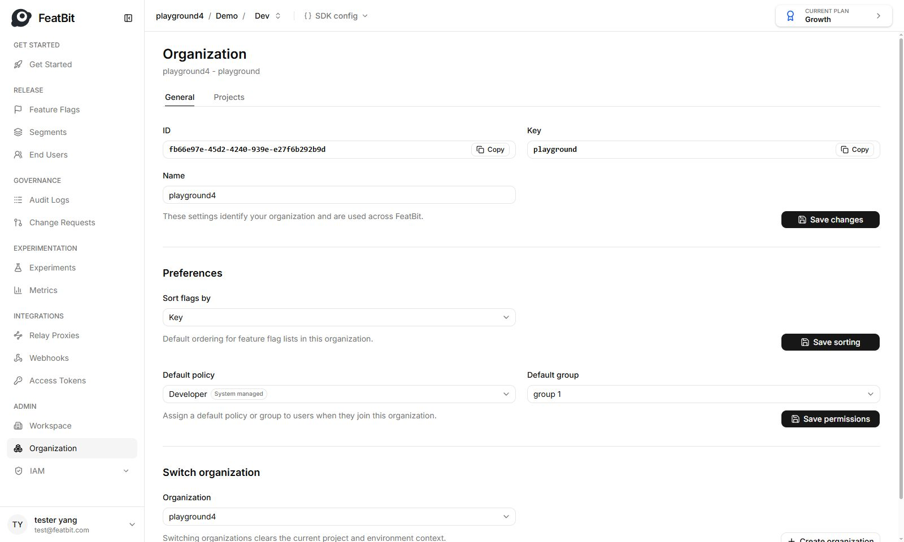

## Prerequisites

Before you start to manage access control, you should:
- Have members created in your organization. You can refer to [Team Management](./teams.md) to add members.
- Have groups (member collections) created in your organization. You can refer to [Group Management](./groups.md) to add groups.

## Quick Start

You can go section [`Example Walkthrough`](#example-walkthrough) directly to see a complete example of how to manage access control for an organization with multiple projects and multiple teams.

## Project Access Control

After you switch to the organization you want to manage, you will see all projects under this organization as shown below:

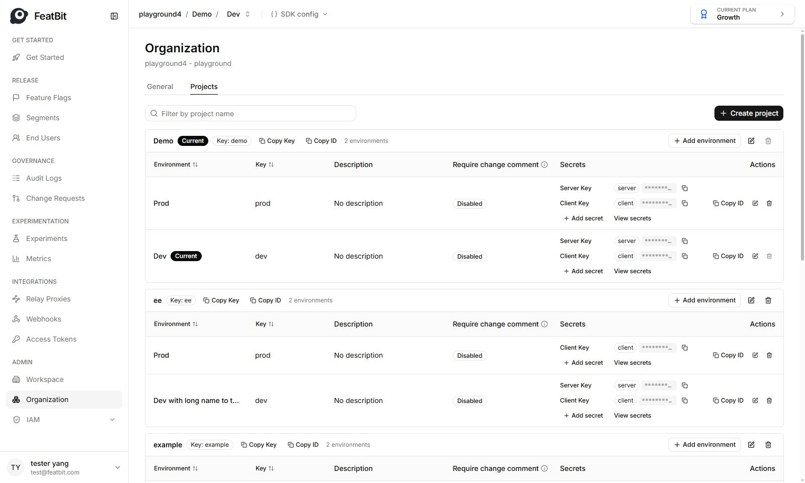

In the next sub-sections, we will show you how to manage access control for projects under this organization.

### Enable User Access to Specific Projects

1. Go to the `Policies` page under `IAM` menu.
2. Click on `Add policy` button, input the policy name, key and description, then click `Save`.
3. In the policy detail page, click on `+ Add permission` button to add a new permission
    - In allow or deny selector, choose `Allow`.
    - Choose `Project` as the control-level (resource type).
    - Choose `Specific resources`
    - Select the project you want to allow access to in resource selector.
    - In action selector, choose `CanAccessProject`.

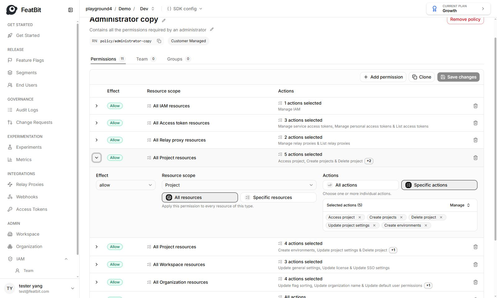

4. Click **Save changes** to save the permission.
5. Go to `Team` or `Groups` tab to assign this policy to members or groups.

In the picture above, we assign the `policy/allow-access-project-a` policy to all groups that need to access `Project A`.

### Set Project Management Permissions

For groups like `Project Maintainers` and `Project Owner`, they need more permissions to manage the project, such as creating environments, creating feature flags, etc.

1. Go to the `Policies` page under `IAM` menu.
2. Click on `Add policy` button, input the policy name, key and description, then click `Save`.
3. In the policy detail page, click on `+ Add permission` button to add a new permission
    - In allow or deny selector, choose `Allow`.
    - Choose `Project` as the control-level (resource type).
    - Select the `project/dev` in resource selector to assign management permissions for `dev`.
    - In action selector, assign all permissions that the group needs. E.g. all permissions for project owner.

4. Click **Save changes** to save the permission.
5. Go to `Team` or `Groups` tab to assign this policy to members or groups.

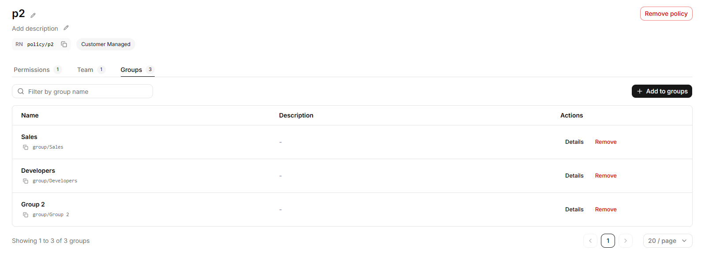

As shown in the picture above, we assign the `policy/p2` policy to `Sales` group. Because only project owner should have full management permissions for the project, such as deleting project.

## Environment Access Control

For each project, you can have multiple environments, such as `development`, `staging`, and `production`. You can also control who can access each environment and what management permissions they have for each environment.

For example, developers of Project A can see all environments under Project A, but they can only create and manage feature flags in the `development` environment. They can only read feature flags in the `production` environment.

### Enable User Access to Specific Environments

1. Go to the `Policies` page under `IAM` menu.
2. Click on `Add policy` button, input the policy name, key and description, then click `Save`.
3. In the policy detail page, click on `+ Add permission` button to add a new permission
4. Add a project access permission first, if not already added:
5. Add an environment access permission:
    - In allow or deny selector, choose `Allow`.
    - Choose `Environment` as the control-level (resource type).
    - Select the environment you want to allow access to in resource selector.
    - In action selector, choose `CanAccessEnvironment`.

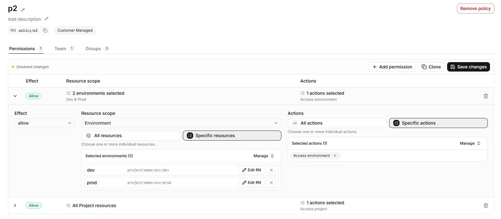

As shown above, we create a policy to allow access to `dev` and `prod` environment in `Project A`.

6. Click **Save changes** to save the permission.
7. Assign this policy to members or groups in `Team` or `Groups` tab.

As shown above, we assign the policy to the `Sales` related groups. They should all able to read feature flags in both `dev` and `prod` environments.

### Set Environment Management Permissions

We may assign a environment maintainer roles to allow them to modify environment settings, such as update environment secret. In this case, we need to create a policy to allow them to manage the environment, as image below:

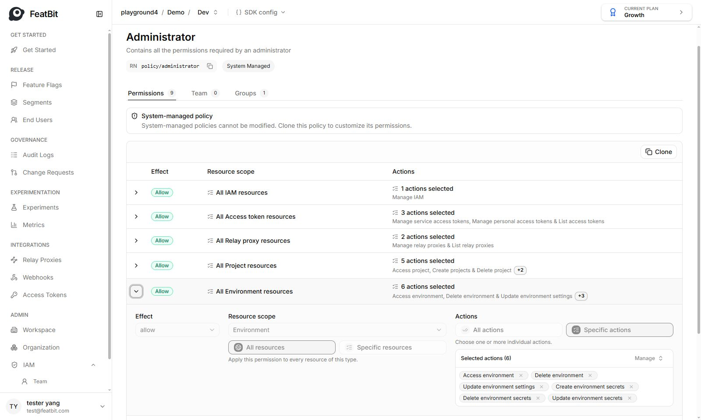

- In allow or deny selector, choose `Allow`.
- Select `Environment` as the control-level (resource type).
- Select the specific environment in resource selector.
- In action selector, choose `DeleteEnvSecret`, `CanAccessEnv` and `UpdateEnvSettings`.
- Save the permission and assign the policy to the related groups.

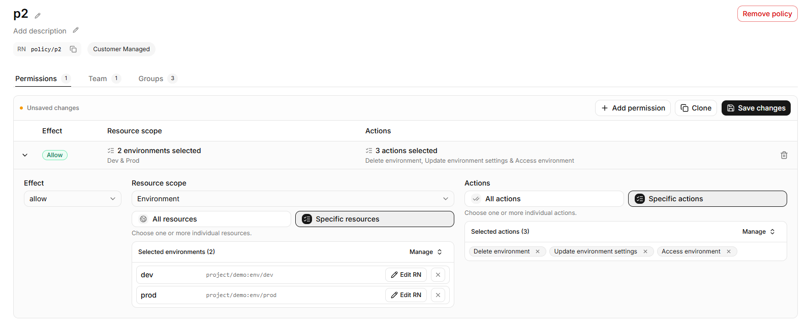

As shown above, we assign the policy to the member `project-a-owner@featbit.com`, who should be able to update environment settings.

## Feature Flag Access Control

Before read or operate a feature flag access control, **make sure the user has access to the project and environment where the feature flag belongs to**.

### Enable User to Operate Feature Flags of Specific Projects/Environments

We will create a policy that includes only permission settings for feature flag in a specific project/environment.

1. Go to the `Policies` page under `IAM` menu.
2. Click on `+ Add policy` button, input the policy name, key and description, then click `Save`.
3. In the policy detail page, click on `(+)` icon to add a new permission
    - In allow or deny selector, choose `Allow`.
    - Choose `Feature Flag` as the control-level (resource type).
    - Select `All resources`.
    - In action selector, choose `All actions`.

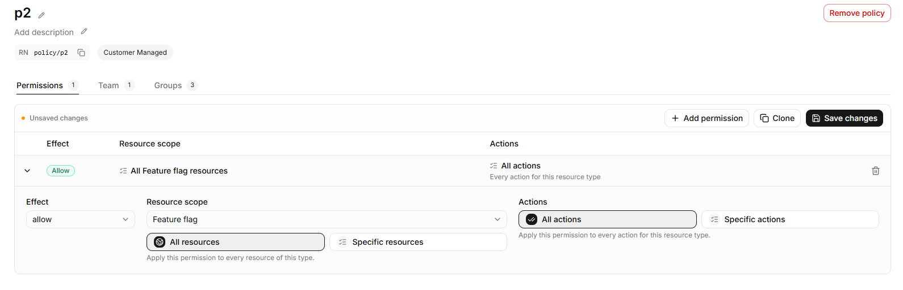

4. Click **Save** to save the permission.
5. Go to `Team` or `Groups` tab to assign this policy to members or groups that need to operate feature flags in the specific project/environment.

## Limit Access to Specific Resources with Custom Resource Names (RN)

> Available since FeatBit [v6.1.3](https://github.com/featbit/featbit/releases/tag/6.1.3).

The resource selector lists the projects and environments that exist in your organization. When you need a narrower or broader scope than that list offers, such as **only one feature flag**, **every flag whose key starts with `checkout-`**, or **every flag tagged `team-payments`**, you can add a custom resource name (RN) to the permission.

Custom RNs are supported for the `Project`, `Environment`, `Feature Flag` and `Segment` control levels, in both IAM policies and [service access tokens](../integrations/api-access-tokens.md).

### Resource name format

An RN describes a path from the project down to the resource. Each level is written as `type/key` and levels are joined by `:`. Flags and segments can also carry tags after a `;`.

| Control level | RN format | Example |
| --- | --- | --- |
| Project | `project/<project-key>` | `project/demo` |
| Environment | `project/<project-key>:env/<env-key>` | `project/demo:env/prod` |
| Feature Flag | `project/<project-key>:env/<env-key>:flag/<flag-key>` | `project/demo:env/prod:flag/new-checkout` |
| Segment | `project/<project-key>:env/<env-key>:segment/<segment-key>` | `project/demo:env/prod:segment/beta-users` |

Matching rules:

- **Keys, not names.** Use the project key, environment key, flag key and segment key. Matching is case-sensitive, so `project/Demo` doesn't match the project `demo`.
- **Wildcards.** `*` matches any characters at that level. Use it alone (`flag/*`) to cover every resource at that level, or with text (`flag/checkout-*`, `flag/*-beta`) to cover every resource whose key matches the pattern.
- **Tags.** Add `;<tag>` to a flag or segment RN to match only resources that have that tag. Separate several tags with commas; a resource matches when it has **any** of them. A tag can end with a wildcard, for example `;team-*`.
- **Characters.** Values can't contain `{`, `}` or `:`.
- **Creating flags and segments.** `CreateFlag` and `CreateSegment` are checked against the whole environment (`flag/*` or `segment/*`), because the new resource doesn't exist yet. A key pattern such as `flag/checkout-*` or a tag filter doesn't grant them. To let a member create flags, allow `CreateFlag` on `project/<project-key>:env/<env-key>:flag/*`.

Some useful patterns:

| RN | What it covers |
| --- | --- |
| `project/demo:env/prod:flag/new-checkout` | Only the `new-checkout` flag in the `prod` environment of `demo` |
| `project/demo:env/*:flag/new-checkout` | The `new-checkout` flag in every environment of `demo` |
| `project/demo:env/prod:flag/checkout-*` | Every flag in `prod` whose key starts with `checkout-` |
| `project/demo:env/prod:flag/*;team-payments` | Every flag in `prod` tagged `team-payments` |
| `project/demo:env/*:segment/*;internal,qa` | Every segment in any `demo` environment tagged `internal` or `qa` |
| `project/*:env/dev` | The `dev` environment of every project |

### Add a custom RN to a permission

The following steps limit a user to changing a single feature flag, `game-runner`, in the `prod` environment of project `featbit-demo`.

1. Go to the `Policies` page under `IAM` menu and open the policy you want to edit (or create one with `Add policy`).
2. Click `+ Add permission` to add a new permission:
    - In allow or deny selector, choose `Allow`.
    - Choose `Feature Flag` as the control-level (resource type).
    - Choose `Specific resources`, then click `Manage`.
3. In the resource picker, click `Add custom RN`. In the dialog:
    - All levels start as `Any` (`*`). Untick `Any project`, `Any environment` and `Any feature flag`, then enter `featbit-demo` in `Project`, `prod` in `Environment` and `game-runner` in `Feature flag`. Leave a level ticked to keep `*` at that level.
    - Optionally, enter tags in `Tags` (for example `team-payments, release`).
    - Check `Resulting resource RN`. It should read `project/featbit-demo:env/prod:flag/game-runner`.
    - Click `Apply`.

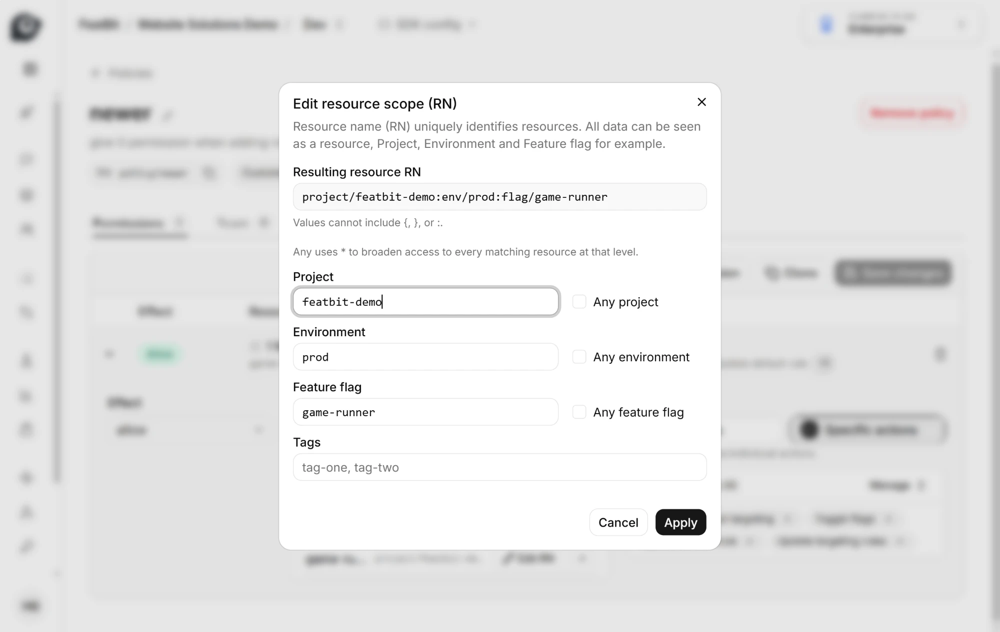

4. Back in the resource picker, the new RN is selected. Click `Done` to apply your selection to the permission. Pressing `Esc` or clicking outside the picker discards the changes.
5. In action selector, choose the actions the user can perform on this flag, for example `Toggle flags` (`ToggleFlag`), `Update default rule` (`UpdateFlagDefaultRule`), `Update individual targeting` (`UpdateFlagIndividualTargeting`) and `Update targeting rules` (`UpdateFlagTargetingRules`). Click `Done`. The permission now looks like this:

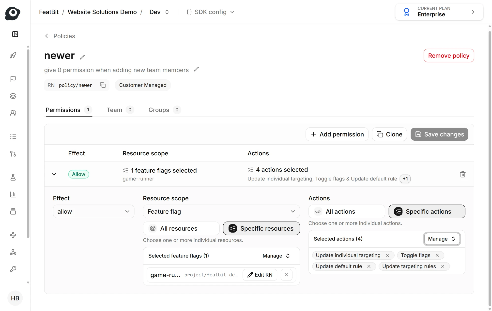

6. Click **Save changes**, then assign the policy to members or groups in the `Team` or `Groups` tab.

To change an RN later, click `Edit RN` next to it in the selected resources list. A policy can't contain the same RN twice.

> **Note:** Selecting individual actions for the `Feature Flag` and `Segment` control levels requires the Fine-grained access control add-on. Without it, a custom RN can still be used with `All actions`.

### What the user can see and change

Flag and segment RNs control what a user can **change**. Viewing is controlled by the project and environment permissions:

- To see the flag at all, the user still needs `CanAccessProject` on the project and `CanAccessEnv` on the environment (see [Project Access Control](#project-access-control) and [Environment Access Control](#environment-access-control)).
- `CanAccessEnv` lets the user view every flag and segment in that environment. With the policy above, the user can open any flag in `prod`, but can only change `game-runner`. Other flags are read-only for them.
- Make sure the user doesn't also have a broader policy (such as a built-in Developer policy) that allows changes to all flags. Permissions from every policy add up.

### Combine allow and deny

Because a `Deny` always wins over an `Allow`, you can grant a broad scope and carve out exceptions:

- `Allow` all flag actions on `project/demo:env/prod:flag/*`.
- `Deny` all flag actions on `project/demo:env/prod:flag/*;locked`.

Members with this policy can manage every flag in `prod` except the ones tagged `locked`. See [Policies](./policies.md#policy-algorithm) for how FeatBit evaluates allow and deny statements.

## Example Walkthrough

### Context

Imaging that in an organization, we have multiple projects. We have the following requirements:

- A specifc member that own the `Project A`: Can do everything for `Project A`.
- QAs can access both `Project A` and `Project B`, but they can only view feature flags, not operate them.
- PMs in the group `PM Team A` can do everything for feature flags in `Project A`, except delete feature flags.
- Developers in the group `Dev Team A`:
    - Can do everything for feature flags in `Project A`, `dev` environment.
    - Only view feature flags in `Project A`, `prod` environment, and only allow to operate one specific feature flag.
- External developers in the group `External Devs`:
    - Can only view and operate feature flags in `Project A`, `dev` environment.

### Solution

To achieve the above requirements, we need to create the following policies:
- Policy `Project A Maintainer` to allow full access to Project A (all environments) for given members. [See [Policy `Project A Maintainer`](#policy-project-a-maintainer)].
- Policy `Project A QA` to allow read-only access to Project A (all environments). [See [Policy `Project A QA`](#policy-project-a-qa)].
- Policy `Project A PM` to allow full access to Project A's all feature flags except create and archive action. [See [Policy `Project A PM`](#policy-project-a-pm)].
- Policy `Project A Dev` to allow [See [Policy `Project A Dev`](#policy-project-a-dev)]: 
    - Full access to Project A's feature flags in `dev` environment.
    - Read-only access to Project A's feature flags in `prod` environment.
    - Allow operate a specific feature flag in `prod` environment.
- Policy `Project A External Dev` to allow [See [Policy `Project A External Dev`](#policy-project-a-external-dev)]:
    - Read and operate access to Project A's feature flags in `dev` environment.

### Policy `Project A Maintainer`

1. Create a policy named `Project A Maintainer`. Resource Name (RN) is `policy/policy/Project A Maintainer`.
2. Add a permission for project level access:
    - Control Level: `Project`
    - Resource Selector: `project/demo`
    - Allow or Deny: `Allow`
    - Actions: all actions for project owner.
3. Add a permission for environment level access:
    - Control Level: `Environment`
    - Resource Selector/Editor: `project/demo:env/dev`, `project/demo:env/prod`
    - Allow or Deny: `Allow`
    - Actions: `CanAccessEnv`
4. Add a permission for feature-flag level access:
    - Control Level: `Feature Flag`
    - Resource Selector: `All resources`
    - Allow or Deny: `Allow`
    - Actions: all actions for feature flags.

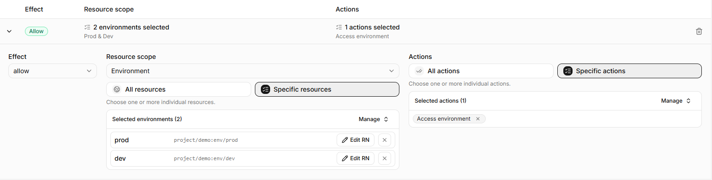
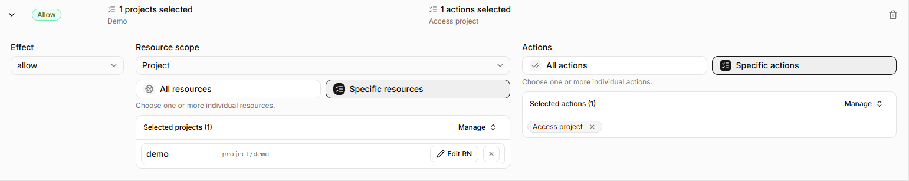
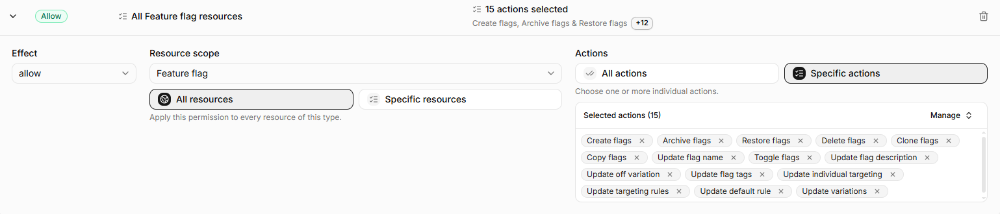
5. Save the policy and assign it to member `33@gg.com`

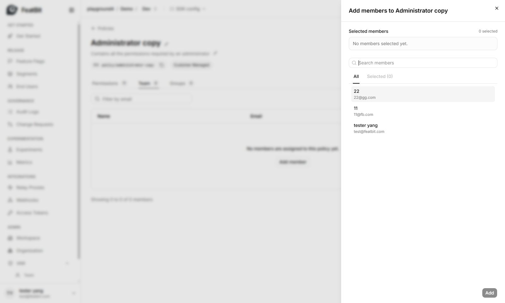

NOTE: Be sure that the member has removed their default policy assignments, otherwise they may still have more permissions than expected.

### Policy `Project A QA`

1. Create a policy named `Project A QA`. Resource Name (RN) is `policy/policy/Project A QA`.
2. Add a permission for project level access:
    - Control Level: `Project`
    - Resource Selector: `project/demo`
    - Allow or Deny: `Allow`
    - Actions: `CanAccessProject`
3. Add a permission for environment level access:
    - Control Level: `Environment`
    - Resource Selector/Editor: `project/demo:env/dev`, `project/demo:env/prod`
    - Allow or Deny: `Allow`
    - Actions: `CanAccessEnv`

4. Save the policy and assign it to group `Project A QAs`.

NOTE: Be sure that all members in QA groups have removed their default policy assignments, otherwise they may still have more permissions than expected.

### Policy `Project A PM`

Other than policy `Project A Maintainer`, PMs should not have permissions to create, archive or delete feature flags in each environments in `Project A`. Other permissions are the same as maintainers.

1. Create a policy named `Project A PM`. Resource Name (RN) is `policy/policy/Project A PM`.
2. Add a permission for project level access:
    - Control Level: `Project`
    - Resource Selector: `project/demo`
    - Allow or Deny: `Allow`
    - Actions: `CanAccessProject`
3. Add a permission for environment level access:
    - Control Level: `Environment`
    - Resource Selector/Editor: `project/demo:env/dev`, `project/demo:env/prod`
    - Allow or Deny: `Allow`
    - Actions: `CanAccessEnv`
4. Add a permission for feature-flag level access:
    - Control Level: `Feature Flag`
    - Resource Selector: `All resources`
    - Allow or Deny: `Allow`
    - Actions: all actions except `CreateFlag`, `ArchiveFlag` and `DeleteFlag`.

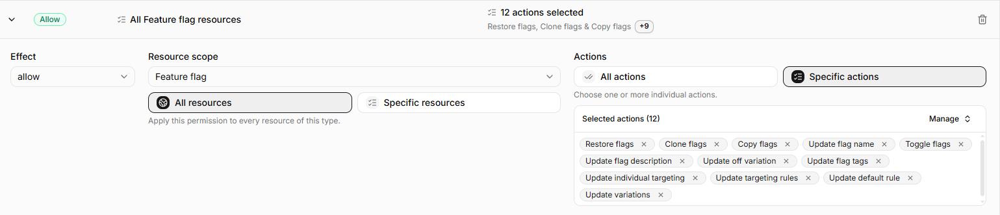

5. Save the policy and assign it to group `PMs`.
6. Assign the policy to all members in the group `PMs`.

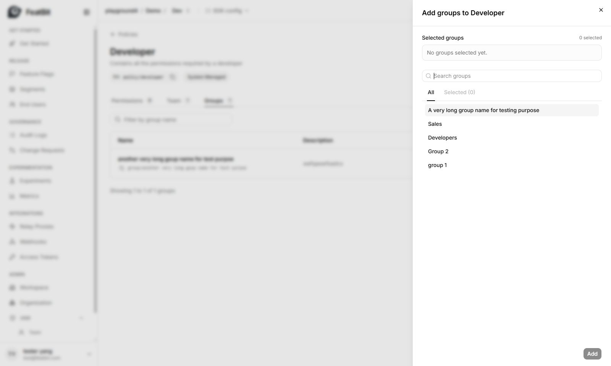

NOTE: Be sure that all members in `Project A PMs` groups have removed their default policy assignments, otherwise they may still have more permissions than expected.

### Policy `Project A Dev`

Different from the policies above, this subsection shows how to combine two policies to meet the requirements for developers in `Project A`.

- Policy `Project A QA` (created above) to allow read-only access to Project A (all environments). This policy already meets the read-only access requirement for the `prod` environment.
- Policy `Project A Dev`:
    - Full access to `dev` environment.
    - Allow to operate a specific feature flag in `prod` environment.

Create the policy `Project A Dev` as below:

1. Create a policy named `Project A Dev`. Resource Name (RN) is `policy/Project A Dev`.
2. Add a permission for feature-flag level access in `dev` environment:
    - Control Level: `Feature Flag`
    - Resource Selector: `All resources`
    - Allow or Deny: `Allow`
    - Actions: all actions for feature flags.
3. Add a permission for specific feature-flag in `prod` environment:
    - Control Level: `Feature Flag`
    - Resource Selector: `Specific resources`, then add the custom RN `project/demo:env/prod:flag/<flag-key>` (see [Limit Access to Specific Resources with Custom Resource Names (RN)](#limit-access-to-specific-resources-with-custom-resource-names-rn))
    - Allow or Deny: `Allow`
    - Actions: `UpdateFlagTags`, `UpdateFlagDefaultRule`, `UpdateFlagIndividualTargeting`, `UpdateFlagTargetingRules`

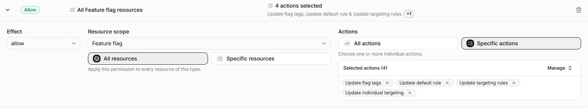
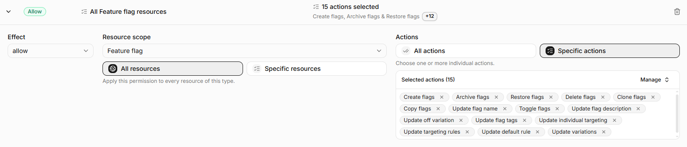

5. Save the policy.
6. Assign both policies `Project A QA` and `Project A Dev` to group `Project A Devs`.

This combination may not satisfy your feeling caused by `Project A QA` name, but it shows you another way to achieve complex access control requirements by combining multiple policies.

### Policy `Project A External Dev`

We create all permissions in a single policy for external developers.

1. Create a policy named `Project A External Dev`. Resource Name (RN) is `policy/Project A External Dev`.
2. Add a permission for project level access:
    - Control Level: `Project`
    - Resource Selector: `project/demo`
    - Allow or Deny: `Allow`
    - Actions: `CanAccessProject`
3. Add a permission for environment level access in `dev` environment:
    - Control Level: `Environment`
    - Resource Selector/Editor: `project/demo:env/dev`
    - Allow or Deny: `Allow`
    - Actions: `CanAccessEnv`
4. Add a permission for feature-flag level access in `dev` environment:
    - Control Level: `Feature Flag`
    - Resource Selector: `All resources`
    - Allow or Deny: `Allow`
    - Actions: all actions for feature flags.

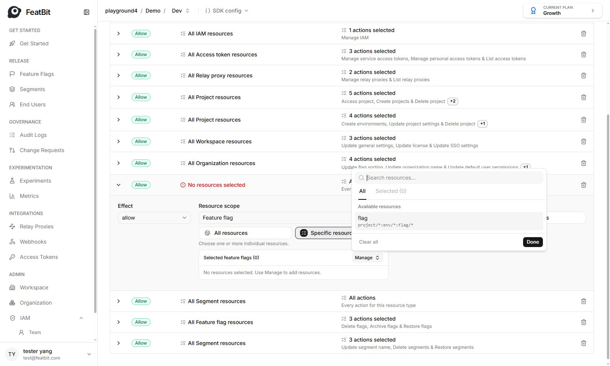
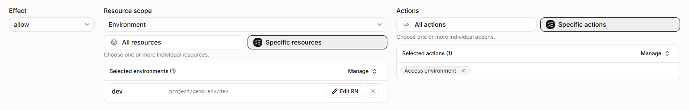

5. Save the policy and assign it to group `External Devs`.

### Conclusion

By following the above steps, we have successfully created and assigned policies to meet the access control requirements for `Project A` in our organization. Each group and member now has the appropriate permissions to access and manage feature flags according to their roles.

Please remember to regularly review and update the policies as needed to ensure that they continue to meet the evolving needs of your organization.

For any unexpected behaviors or issues, please join our [Discord community](https://discord.gg/ytK9xGJSw3) or contact us by email at [contact@featbit.co](mailto:contact@featbit.co)
