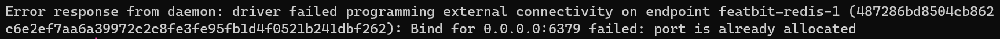

### How to solve docker container port conflict problem

**Q:** How to solve the docker container port conflict problem when I run `docker compose up -d`?

**A:** You just need to change the container port in docker-compose.yml.

For example, if you already have a Redis container using the host machine's port 6379, when you try to launch our system with `docker-compose up -d`, you can see the port conflict error from docker daemon like this



To solve this problem, go to **docker-compose.yml**, find the Redis service and change it's binding port to something other than 6379.

```yaml
# redis service
redis:
  image: bitnami/redis:6.2.7
  container_name: redis
  restart: on-failure
  environment:
    - ALLOW_EMPTY_PASSWORD=yes
  networks:
    - featbit-network
  ports:
    # change the binding port to 6380
    - "6380:6379"
  volumes:
    - redis:/data
```

### How to make FeatBit portal accessible publicly

With the default configuration, the FeatBit's portal is only accessible from the local machine on which you ran docker compose.

To make the UI accessible from other machines or even from the internet, you need a public IP or domain name for the machine on which it is running. Additionally, if the API and Evaluation services are running on different machines than the UI service, you may also need public IP addresses or domain names for them. Then, set the correct values for **API\_URL** and **EVALUATION\_URL** in the docker-compose file. Please check [Application Services](../tech-stack/application-services.md) for a detailed explanation of all the services of FeatBit.

```yaml
# docker-compose.yml
ui:
  image: featbit/featbit-ui:latest
  container_name: ui
  environment:
    # example: 192.168.56.1:5000
    - API_URL=http://[REPLACE_WITH_THE_API_SERVER_IP_OR_DOMAIN]
    # keep it like this, this is for tutorial
    - DEMO_URL=https://featbit-samples.vercel.app
    # example: 192.168.56.1:5100
    - EVALUATION_URL=http://[REPLACE_WITH_THE_EVALUATION_SERVER_IP_OR_DOMAIN]
  depends_on:
    - api-docs-server
  ports:
    - "8081:80"
  networks:
    - featbit-network
```

### Why am I logged out after five minutes when deploying behind a URL path prefix?

**Q:** My FeatBit API is deployed behind a path prefix such as `/deployment-prefix/manage`. Why does the portal return to the login page after five minutes?

**A:** The browser must send the refresh token cookie when the access token expires. If the cookie's path does not include your public API prefix, the browser will omit it from the refresh request and session renewal will fail.

Set `Authentication__RefreshTokenCookiePath` on the **API service** to the full public identity path. For example, if the refresh endpoint is `/deployment-prefix/manage/api/v1/identity/refresh-token`, add the following environment variable to the API service's existing configuration in `docker-compose.yml`:

```yaml
api-server:
  environment:
    - Authentication__RefreshTokenCookiePath=/deployment-prefix/manage/api/v1/identity
```

Replace `/deployment-prefix/manage` with your actual public API prefix. The value must start with `/` and include `/api/v1/identity`; do not include the hostname or `/refresh-token`.

Recreate the API container to apply the environment variable, clear the old `refresh-token` cookie in your browser, and sign in again.

If the variable is unset or empty, the API uses `Request.PathBase + /api/v1/identity`. When `PathBase` is empty, the default remains `/api/v1/identity`, so deployments without a path prefix do not need this setting.
